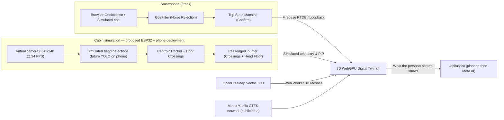

# CommuteAI

### Making every seat, stop and peso count.

**Know which jeepney you can catch. Help drivers notice the passengers they might miss. Make fuel decisions with the cost in view.**

CommuteAI is a Meta AI-powered transport prototype for Philippine jeepneys. It brings commuters, drivers and operators into a shared 3D world where seats, queues, walking journeys and vehicle movements inform the next decision—with questions and explanations in English, Tagalog or Taglish.

**Built for the Meta Global AI Developer Hackathon · OpenStreetMap geography · Voice and contextual guidance · Simulation-led product development**

[Explore the evidence and savings math](./docs/evidence-and-decision-math.md) · [Read the product and technical notes](./Notes.md) · [Inspect saved experiments](./docs/simulation-results/README.md)

## The moments we want to improve

**“May paparating pang pasahero?”** A driver has empty seats while people are walking or taking a tricycle toward the next stop. CommuteAI's demo shows who is approaching, how far away they are and whether they are expected before the jeepney—so the driver can recheck the situation on arrival.

**“Aabot ba ako—and may upuan pa?”** The nearest jeepney is not always the one a commuter can board. The demo considers their arrival at the stop, passengers ahead in the queue and estimated seats after drop-offs.

**“Saan mas sulit magpakarga?”** A lower diesel price matters only if the station is usable and reachable. The driver view shows stations ahead on the route, dated price estimates, simulated tank information and the possible saving on a top-up.

**“May mas malapit bang sakayan?”** The planner compares mapped boarding stops and walking/tricycle access. Our next-step proposal is to help a commuter reach a verified pickup point from a secondary road when it is closer and the jeepney can still be caught. Dynamic roadside rendezvous is a proposed extension, not a completed feature.

## A product prototype with a path to the road

**We intend to develop CommuteAI into an actual live product. Today, it is a demo-product prototype built through simulation.** Our team currently lacks the funding to produce and install the camera hardware and run a real fleet pilot. We are using the demo to develop the experience, test decision logic and make the next investment concrete.

The software includes browser GPS tracking, planning logic and Meta API integrations. The proposed deployment connects an ESP32 camera to a phone running a YOLO-based passenger detector, then shares occupancy and GPS with the planner. Physical camera integration, dependable live demand data and field-validated savings still need engineering and testing. A convincing simulation is a starting point for that work, not proof of production readiness.

| Experience | What you can explore today |
| --- | --- |
| **Commuter view** | Catchable jeepneys, queue-aware seat estimates, fares and direct/one-transfer trip options. |
| **Driver view** | Stop/pass reasons, approaching passengers, stations ahead, trip budgets and modelled earnings. |
| **Operator's 3D twin** | A focused route simulated vehicle by vehicle and rider by rider, with working days, terminal queues and estimated activity on the surrounding network. |
| **Sensor lab** | A virtual cabin camera, simulated detections and passenger-counting logic compared with simulation ground truth. |
| **Profit & service lab** | Compare operating policies and inspect what happens to driver costs, waiting times and service—not just the most favourable number. |

## What Meta AI adds

Ask about the situation in your own words. Meta transcription handles recorded questions; the configured Meta language model explains the relevant screen and computed plan in context. The planner calculates fares, seats and arrival estimates. Optional ElevenLabs/Azure or browser speech reads replies aloud.

The product hypothesis is that understandable voice guidance helps people act on information they would otherwise miss. We will measure that benefit against planner-only use. A deterministic fallback keeps the demo useful when Meta is unavailable, and its response source is identified separately.

## Real evidence. Visible assumptions. Testable benefits.

Our inputs combine OpenStreetMap geography, historical transit information, transport research and a dated DOE fuel-price snapshot. Passenger demand and many operating parameters remain simulated. The [evidence guide](./docs/evidence-and-decision-math.md) links verified references from **2016, 2018, 2021, 2023 and 2026** and explains which numbers are measured, published scenarios or assumptions.

It also works through the decisions rather than promising a universal savings percentage:

- **Approaching passengers:** additional fares minus waiting fuel, operating costs and lost earnings elsewhere; onboard passenger delay counts too. A bounded roadside hold is proposed, not currently automated.
- **Cheaper diesel:** purchase-price savings minus additional costs, subject to fuel reserve and on-route reachability.
- **A closer pickup:** walking time plus crossing/access time and an uncertainty buffer must fit within the jeepney's arrival time.

These examples are illustrative arithmetic, not field results. The next step is a small corridor pilot that measures driver take-home income, fuel use, missed pickups and commuter journey times together.

## Open geography, lower mapping barriers

OpenStreetMap data, delivered through [OpenFreeMap](https://openfreemap.org/), supplies the roads, buildings, water and parks in the twin without a map API key. This avoids Google Maps usage charges; [Google Maps Platform](https://developers.google.com/maps/billing-and-pricing/overview) has free usage caps and usage-based billing. The mapping integration is part of CommuteAI's reported hackathon work.

## Try the demo locally

```sh
npm install
npm run dev
```

Open `http://localhost:5173` for the twin. In a second window, open `http://localhost:5173/track.html` and select **Simulate a ride** to test the tracker indoors. Same-browser loopback needs no Firebase setup. Real phone-to-dashboard tracking requires Firebase configuration and HTTPS; Meta voice/context features require server-side credentials. See the developer guide below.

For a quick tour: inspect a jeepney in **Live twin**, compare **Driver** and **Commuter** views, ask a contextual question, then explore the **Sensor lab** and **Profit & service lab**. Check whether each result is simulated, estimated or supplied by live GPS.

## Building toward a pilot

We welcome collaboration with drivers, cooperatives, operators and hardware partners who can help validate one corridor. Funding would support camera kits and installation, phone compatibility, connectivity, labelled test footage and field evaluation. The [pilot plan](./docs/evidence-and-decision-math.md#a-practical-pilot-and-funding-path) sets out what must be measured before claiming real-world impact.

**Hackathon disclosure:** the author reused a pre-existing 3D foundation. New CommuteAI transport features and integrations are described in [Notes.md](./Notes.md), alongside recorded development dates and remaining provenance details. Existing libraries, geographic data and the reused foundation are not claimed as newly authored work.

<details>
<summary><strong>Developer guide: architecture, controls, setup and verification</strong></summary>


## 📌 Overview

Two pages, one repository, one deployment:

| Page                                        | Who Uses It                   | What It Does                                                                                                                                                                                                                                                                              |
| ------------------------------------------- | ----------------------------- | ----------------------------------------------------------------------------------------------------------------------------------------------------------------------------------------------------------------------------------------------------------------------------------------- |
| **`/`** ([`index.html`](./index.html))      | Laptop / operations dashboard | 3D WebGPU twin on real OpenStreetMap buildings and roads, with five views (below).                                                                                                                                                                                                        |
| **`/track`** ([`track.html`](./track.html)) | Smartphone inside the jeepney | Shares live GPS for one session, or a **simulated ride** along Tungko – SM City Fairview for testing indoors. Runs the uncertainty-gated GPS filter and trip state machine (`WAITING → POSSIBLE_VEHICLE → CONFIRMED → ENDED`); the rider confirms which jeepney they are on. No Three.js. |

The dashboard's views (tabs in the header):

| View                     | Whose screen         | What it shows                                                                                                                                                                                                                                                                                                                                                                                                |
| ------------------------ | -------------------- | ------------------------------------------------------------------------------------------------------------------------------------------------------------------------------------------------------------------------------------------------------------------------------------------------------------------------------------------------------------------------------------------------------------ |
| **Live twin**            | The operator         | The focused route simulated in full (default **Tungko – SM City Fairview**, 60 jeepneys, a working day from 5 AM: drivers set out, rush-hour traffic, terminal lines, refuelling, boundary and owner-drivers, riders walking or taking a tricycle from the side streets), every other GTFS route as an estimated flow, phones on the road, the fleet's money, every jeepney's data (CSV), and the assistant. |
| **Profit & service lab** | The operator         | Opened from the Live twin. One corridor's fleet over 30-day months, with and without CommuteAI (and with the Muse voice assistant), in a background worker; ledger and audit export.                                                                                                                                                                                                                         |
| **Driver app**           | One driver's phone   | Next stop STOP / PASS and why, stops ahead, people approaching, the jeepney in front, diesel to the terminal, gas stations ahead with DOE prices, my earnings, and voice questions ("Hey Commute, …").                                                                                                                                                                                                       |
| **Commuter app**         | One commuter's phone | Trip planner anywhere in Metro Manila (direct or one change, walk or tricycle to the stop), which jeepney takes you and whether it has a seat for you, fare by rider type, and following your own trip through the twin.                                                                                                                                                                                     |
| **Sensor lab**           | Test bench           | The simulated cabin camera's count next to simulation ground truth, with pipeline telemetry.                                                                                                                                                                                                                                                                                                                         |

The simulated day keeps running while you are in the Profit & service lab or the Sensor lab.



---

## 🛠️ Tech Stack & Why

| Layer            | Choice                                                            | Version                        | Reason                                                                                                     |
| ---------------- | ----------------------------------------------------------------- | ------------------------------ | ---------------------------------------------------------------------------------------------------------- |
| **UI**           | React + TypeScript (strict)                                       | `^19.3.1` / `^6.0.3`           | Typed contracts between phone, transport, simulation, and 3D scene                                         |
| **3D Engine**    | Three.js + React Three Fiber, **`WebGPURenderer`**                | `^0.186.1` / `^9.8.2`          | WebGPU where available with automatic WebGL2 fallback; identical code across devices                       |
| **3D Helpers**   | `@react-three/drei`                                               | `^10.7.9`                      | `MapControls` orbit/pan controller                                                                         |
| **Styling**      | SCSS (`sass-embedded`, tokens + partials)                         | `^1.106.1`                     | Light/dark themes via CSS variables with zero runtime CSS-in-JS cost                                       |
| **Motion**       | GSAP (`@gsap/react`)                                              | `^3.15.0`                      | Smooth camera transitions and counter badge flashes, never blocking the 60 FPS loop                        |
| **State**        | Zustand for UI + plain TS classes for sim                         | `^5.0.16`                      | 60 FPS vehicle/passenger simulation state never triggers React re-renders                                  |
| **Server / AI**  | Serverless functions in [`/api`](./api)                           | Node `>=22`                    | Keeps API keys server-only; Meta chat and transcription; optional ElevenLabs/Azure speech output             |
| **Realtime**     | Firebase Realtime Database + Loopback                             | `^13.1.0`                      | Streams phone GPS to laptop over the internet (or zero-config across browser tabs)                         |
| **3D Map**       | OpenFreeMap vector tiles (`@mapbox/vector-tile`, `pbf`, `earcut`) | `^3.0.0` / `^5.1.2` / `^3.2.4` | Free, no API key, real extruded 3D buildings, roads, water, and parks built in a Web Worker                |
| **Build & Test** | Vite + Vitest + ESLint + Prettier                                 | `^8.3.5` / `^5.0.5`            | Multi-page build, HTTPS phone dev mode, the `/api` functions in the dev server, unit and integration tests |

---

## 🎮 Interactive 3D Controls & Camera Modes

- **Over the map:** the camera toolbar is at the top left (whole route, street view, choose or ride a jeepney, Front POV, Inside view, FOV cone). The simulation's clock and settings are at the bottom left: day and time, speed (paused to 300×), skip nights, other routes shown or hidden, and **All jeepneys data**.
- **Click any jeepney in 3D:** its **body** follows it from outside; its **front cab** puts you in the seat beside the driver (Front POV, with a rear-view mirror). A jeepney of another route focuses that route: the twin takes it over from its flow, the jeepneys where they were.
- **Ride a jeepney / Next jeepney** picks the next one out on the road (parked ones are off the road and not drawn); at night, when all are parked, any.
- **Outside view:** left-drag to orbit, scroll to zoom up to the windows, right-drag to pan, all while the jeepney moves.
- **Inside view:** through the ceiling-mounted ESP32-S3-CAM lens, with the camera's detections in the picture-in-picture.

---

## 📂 Repository Layout

```text
api/                          Serverless functions (server-only keys)
  assist.ts                   POST /api/assist      planner answer, then Meta AI explains it (cached 60 s)
  plan.ts                     POST /api/plan        the deterministic planner only (no credit)
  transcribe.ts               POST /api/transcribe  Muse voice transcription of one recorded question
  speak.ts                    POST /api/speak       Filipino/English voice (ElevenLabs or Azure), optional
  health.ts                   GET  /api/health      which server features are configured
  _lib/                       Meta client, planner, arrival advice (shared code, not routes)
public/data/                  Metro Manila network (GTFS routes and stops), landmarks, gas stations
src/
  core/                       Pure TypeScript domain and simulation logic (no React/Three, unit tested)
    advisory/                 What the driver, commuter and operator screens say; dispatch; trip budgets
    economics/                The profit model behind the Profit & service lab (runs in a worker)
    fleet/                    FleetSim: the focused route's jeepneys through the day; scenarios
    network/                  The GTFS network, route flows, trip planning, place search
    people/                   Riders: first mile, queues, boarding/alighting choreography, side streets
    doorway/                  Cabin camera pipeline: detector model, CentroidTracker, PassengerCounter
    fuel/                     Gas stations and DOE diesel prices
    geo/ tracking/ map/       Projection and routes; GPS filter, trip state, live vehicles; map tiles
  data/                       Bundled route: Tungko – SM City Fairview; fuel and diesel data
  map/                        Tile loader + Web Worker that builds map meshes off the main thread
  net/                        Transport (Firebase or same-browser loopback), /api clients, voice
  app/                        App shell, Zustand store, TwinRuntime & DoorwayRuntime, network glue
  scene/                      R3F + WebGPU: camera rig, instanced jeepneys and people, PiP renderer
  ui/                         Header, toolbar, panels, the phone apps, the Profit & service lab
  tracker/                    The phone tracker (/track), including the simulated ride
  styles/                     SCSS design tokens, base, components, dashboard and tracker styles
scripts/                      Build the network, places and fuel data; fetch routes; ROI simulation
database.rules.json           Firebase Realtime Database rules (auth required, payload validated)
Notes.md                      Hardware cost proof, pipeline checklist, math models, file reference
```

---

## 🚀 Getting Started

### 1. Install & Run Locally

```bash
npm install
npm run dev          # http://localhost:5173 (twin) and http://localhost:5173/track.html (phone tracker)
```

`npm run dev` also serves the `/api` functions, reading their keys from `.env` (see step 4). Without keys the assistant still answers from the deterministic planner. `vercel dev` works too.

**Zero-config first look:** Without Firebase credentials in `.env`, the app uses a same-browser loopback (`BroadcastChannel`). Open `/` in one window and `/track.html` in a second window beside it; tick **Simulate a ride** and start: a phone-driven jeepney drives along Tungko – SM City Fairview on the dashboard, under **Phones on the road**. Keep the tracker visible (its own window, not a background tab): browsers slow down timers in background tabs.

### 2. Run Tests, Typecheck, Lint & Production Build

```bash
npm test             # Vitest unit and integration tests (the long simulations take ~10 minutes)
npm run typecheck    # tsc -b --noEmit
npm run lint         # ESLint across all TypeScript/React files
npm run build        # Typechecks and builds production bundles into dist/
```

### 3. Smartphone → Laptop Live Demo (Over Wi-Fi / Internet)

1. Create a free Firebase project (Spark plan). Add a **Web app**, enable **Realtime Database**, and enable **Authentication → Sign-in method → Anonymous**.
2. Copy [`.env.example`](./.env.example) to `.env` and fill in the `VITE_FIREBASE_*` values.
3. Deploy the database security rules:
   ```bash
   npx firebase-tools deploy --only database
   ```
4. Mobile browsers require HTTPS for Geolocation. Either deploy to Vercel, or run:
   ```bash
   npm run dev:phone
   ```
   and open `https://<your-laptop-LAN-IP>:5173/track.html` on your phone (accept the local self-signed certificate).

### 4. Meta AI Assistant and Voice (`/api`)

Set `META_API_KEY`, `META_MODEL` (the model ID from the Meta Hackathon portal), and optionally `META_API_BASE` (`https://api.llama.com/compat/v1`) in `.env` for local development, and in **Vercel → Project → Settings → Environment Variables** for the deployment. `META_SAVE_CREDITS=true` answers from the planner only (no credit spent). For a Filipino reading voice, set `ELEVENLABS_API_KEY` (or `AZURE_SPEECH_KEY` + `AZURE_SPEECH_REGION`). None of these is ever sent to the browser.

---

## 🗺️ The 3D Map & Routes

**Added feature: OpenStreetMap/OpenFreeMap integration.** CommuteAI adds real-world geography to the reused 3D foundation using [OpenFreeMap's free vector tile service](https://openfreemap.org/), which requires no API key. This avoids a Google Maps API dependency and its potential usage charges. [Google Maps Platform](https://developers.google.com/maps/billing-and-pricing/overview) has usage-based pricing with free usage caps, so the distinction is avoiding billable map usage rather than claiming every Google Maps request costs money.

The twin opens on **Tungko – SM City Fairview** (Quirino Highway, the bundled route) on a real 3D vector map, with the Metro Manila network around it:

- **3D Map:** OpenStreetMap vector tiles served by [OpenFreeMap](https://openfreemap.org) (free, no API key required), decoded and triangulated in a background Web Worker. Set `VITE_MAP_TILEJSON=off` in `.env` to run without the map.
- **The network:** the routes of the DOTC Philippine Transit GTFS feed (2015, via Sakay.ph) whose OSRM road path fits their stops, in [`public/data`](./public/data). Search a route, or click one of its jeepneys, to simulate it in full.
- **Custom Routes:** `npm run route:fetch -- --relation <osm_id>` or `npm run route:fetch -- --osrm "lng1,lat1;lng2,lat2"`; or record a live GPS trace on `/track.html`, click **Use trace as route** on the dashboard, and **Download**.

---

## ✅ What the System Claims (and What It Does Not)

- **Rider Confirmation Required:** A passenger's phone proves **where the phone is**, not which vehicle it is in. A trip transitions from `POSSIBLE_VEHICLE` to `CONFIRMED` only when the rider explicitly confirms on `/track.html`.
- **Simulated Is Labelled:** a simulated ride's session ID starts with `sim-` and the tracker says it is not the phone's location; the other routes' jeepneys, seats and times are estimates from how a route usually runs, and the app says so where it shows them.
- **Uncertainty-Gated Speed:** GPS displacements smaller than the combined horizontal accuracy $\sqrt{\sigma_0^2 + \sigma_n^2}$ are treated as zero speed, eliminating stationary indoor/tabletop GPS drift.
- **Honest Staleness:** A live vehicle unheard from for `8 s` is marked **stale**, and after `30 s` **lost**. Pose extrapolation along the route is capped at `2 s`.
- **Simulated Cabin Head Counter:** A virtual front-ceiling camera combines 3-frame confirmed doorway transitions with a visible-head lower bound, tested in [`cabinCamera.test.ts`](./src/scene/doorway/cabinCamera.test.ts). Detections are generated from virtual people. ESP32 video capture, YOLO inference on a phone, hardware cost and real-world accuracy remain to be validated.
- **Grounded AI Assistant:** [`api/assist.ts`](./api/assist.ts) first works the answer out with the deterministic planner, then has Meta AI explain only the numbers on the person's screen and in the plan; if Meta is unreachable, the planner's answer is returned.

---

## ⚡ Performance Architecture

- **~14 Draw Calls for the Entire Fleet:** One `InstancedMesh` per material slot renders all jeepneys regardless of fleet size, paired with zero-draw-call local OBB raycasting (`HIT_BOX`) for instant 3D clicking. Other routes' jeepneys: the nearest in full, the rest as simple blocks.
- **9 Draw Calls for All Articulated People:** Every passenger and animated driver is rendered by 9 shared `InstancedMesh` body-part buffers.
- **Zero React Re-Renders on the 60 FPS Loop:** Simulation state lives in plain TypeScript classes ([`TwinRuntime`](./src/app/twinRuntime.ts), [`DoorwayRuntime`](./src/app/doorwayRuntime.ts)) mutated in place inside `useFrame`. HUD panels poll at `0.2–8 Hz`; network-wide totals are worked out every 5 s.
- **Shadow & PiP Optimizations:** Device pixel ratio is capped at `1.75`, the shadow frustum tracks the camera target, and the `320×240` PiP is redrawn at the camera's own 24 FPS, not the screen's.

</details>
