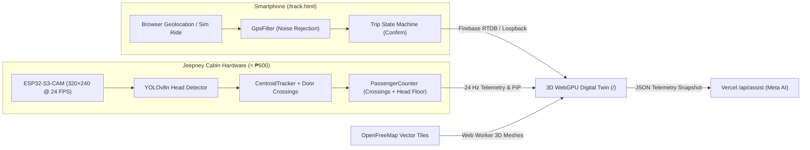

# Meta Hackathon: CommuteAI

**A GPS-anchored 3D WebGPU digital twin of Philippine jeepney transport paired with a validated under-₱600 ESP32-S3-CAM in-cabin passenger counter, real-time smartphone GPS tracking, and a grounded Meta AI operations assistant.**

> 📖 For the complete hardware BOM (`< ₱600`), mathematical models, 6-step ESP32-S3-CAM pipeline checklist, and file-by-file technical reference, see **[`Notes.md`](./Notes.md)**.

---

## 📌 Overview

Two pages, one repository, one deployment:

| Page                                        | Who Uses It                   | What It Does                                                                                                                                                                                                                                                                                                                        |
| ------------------------------------------- | ----------------------------- | ----------------------------------------------------------------------------------------------------------------------------------------------------------------------------------------------------------------------------------------------------------------------------------------------------------------------------------- |
| **`/`** ([`index.html`](./index.html))      | Laptop / Operations Dashboard | 3D WebGPU digital twin: real OpenStreetMap 3D buildings & roads, simulated jeepney fleet, live phone-driven jeepneys, interactive camera views (`Outside 360°`, `Inside ESP32-CAM`, `Front Cab POV`), live `320×240` QVGA Picture-in-Picture head-detection feed, LTFRB fare calculator, **Sensor Lab**, and **Meta AI Assistant**. |
| **`/track`** ([`track.html`](./track.html)) | Smartphone inside the jeepney | Shares live GPS (or simulated ride) for one session, runs the uncertainty-gated GPS filter and trip state machine (`WAITING → POSSIBLE_VEHICLE → CONFIRMED → ENDED`), and lets the rider explicitly confirm they are on the jeepney (~10 kB bundle, zero Three.js overhead).                                                        |



---

## 🛠️ Tech Stack & Why

| Layer            | Choice                                                            | Version                        | Reason                                                                                      |
| ---------------- | ----------------------------------------------------------------- | ------------------------------ | ------------------------------------------------------------------------------------------- |
| **UI**           | React + TypeScript (strict)                                       | `^19.3.1` / `^6.0.3`           | Typed contracts between phone, transport, simulation, and 3D scene                          |
| **3D Engine**    | Three.js + React Three Fiber, **`WebGPURenderer`**                | `^0.186.1` / `^9.8.2`          | WebGPU where available with automatic WebGL2 fallback; identical code across devices        |
| **3D Helpers**   | `@react-three/drei`                                               | `^10.7.9`                      | `MapControls` orbit/pan controller and HTML world-space markers                             |
| **Styling**      | SCSS (`sass-embedded`, tokens + partials)                         | `^1.106.1`                     | Light/dark themes via CSS variables with zero runtime CSS-in-JS cost                        |
| **Motion**       | GSAP (`@gsap/react`)                                              | `^3.15.0`                      | Smooth camera transitions and counter badge flashes, never blocking the 60 FPS loop         |
| **State**        | Zustand for UI + plain TS classes for sim                         | `^5.0.16`                      | 60 FPS vehicle/passenger simulation state never triggers React re-renders                   |
| **Server / AI**  | Vercel Serverless Functions in [`/api`](./api)                    | Node `>=22`                    | Keeps `META_API_KEY` server-only; queries Meta's OpenAI-compatible chat completions API     |
| **Realtime**     | Firebase Realtime Database + Loopback                             | `^13.1.0`                      | Streams phone GPS to laptop over the internet (or zero-config across browser tabs)          |
| **3D Map**       | OpenFreeMap vector tiles (`@mapbox/vector-tile`, `pbf`, `earcut`) | `^3.0.0` / `^5.1.2` / `^3.2.4` | Free, no API key, real extruded 3D buildings, roads, water, and parks built in a Web Worker |
| **Build & Test** | Vite + Vitest + ESLint + Prettier                                 | `^8.3.5` / `^5.0.5`            | Multi-page build, HTTPS phone dev mode, and **66 automated unit/integration tests**         |

**Firebase vs Vercel, in one line:** Vercel runs server-only secrets (the Meta AI call in [`/api/assist`](./api/assist.ts)); Firebase is only the realtime GPS pipe.

---

## 🎮 Interactive 3D Controls & Camera Modes

- **Click Any Jeepney Directly in 3D:**
  - Click a jeepney's **body** in the 3D scene (or choose it from the top toolbar dropdown / right-hand **Simulated fleet** panel) to follow it in **Outside view**.
  - Click the **front cab/hood** of a monitored jeepney (or press **Front POV**) to sit inside the front cab beside the driver and watch the live push-pull steering wheel hand motion, pedal footwork, dashboard gauges, windshield wipers, and road ahead.
- **360° Free Orbit & Zoom (Outside View):**
  - **Left-drag** to rotate 360° around the jeepney cabin (`x = -0.5, y = 1.2`), **scroll** to zoom right up to the windows (`minDistance = 0.35 m`), and **right-drag** to pan—with zero lag or rubber-banding while the jeepney moves and turns.
- **Inside View (ESP32-S3-CAM Lens) & FOV Cone Toggle:**
  - Press **Inside view** to look directly through the ceiling-mounted `ESP32-S3-CAM` wide-angle lens (`(1.2, 2.12, 0)` looking toward the rear doorway `REAR_X = -3.1`).
  - Press **Hide FOV cone / Show FOV cone** in the toolbar (or Sensor Lab panel) to toggle the red 3D camera frustum inside the cabin.

---

## 📂 Repository Layout

```text
api/                          Vercel Serverless Functions (server-only)
  assist.ts                   POST /api/assist  → Meta model explains live twin numbers
  health.ts                   GET  /api/health  → Checks META_API_KEY and META_MODEL
  _lib/meta.ts                Meta OpenAI-compatible chat completions client
src/
  core/                       Pure TypeScript domain & simulation logic (no React/Three, unit tested)
    geo/                      lat/lng ↔ local metres, Polyline (map matching), RDP simplify, route loader
    tracking/                 GpsFilter (noise rejection), TripState machine, LiveVehicle (smoothing + staleness)
    doorway/                  CabinPipeline (24 Hz head detector model), CentroidTracker, PassengerCounter, DoorwaySim
    people/                   RiderMotion (5-stage walk/step/stoop/aisle/turn/sit), StopLayout, PassengerSystem
    map/                      Vector tile → 3D meshes (roads, water, parks, extruded buildings, road clearance)
    fleet/                    FleetSim (simulated jeepneys, headways, stop dwell timers)
    fare.ts                   LTFRB traditional jeepney fare (₱14 first 4 km + ₱2/km, 20% discount)
  data/                       Bundled route: Malaria – SM City Fairview (Quirino Hwy, 6.33 km, 8 OSM stops)
  map/                        Tile loader + Web Worker that builds map meshes off the main thread
  net/                        Transport interface: Firebase Realtime DB or same-browser Loopback; /api client
  app/                        App shell, Zustand store, TwinRuntime & DoorwayRuntime (60 FPS state outside React)
  scene/                      R3F + WebGPU: CameraRig, instanced Sarao jeepneys, articulated 9-mesh people, PiP renderer
  ui/                         Header, ViewControls, TwinPanel, DoorwayPanel, AssistPanel, GSAP CounterBadge, PipOverlay
  tracker/                    Mobile phone GPS web app (/track.html)
  styles/                     SCSS design tokens, base, components, dashboard & tracker stylesheets
scripts/fetch-route.mjs       CLI tool to build a route GeoJSON from OSM relations or OSRM + nearby bus stops
database.rules.json           Firebase Realtime Database rules (auth required, payload schema validated)
Notes.md                      Complete hardware cost proof, pipeline checklist, math models & file reference
```

---

## 🚀 Getting Started

### 1. Install & Run Locally

```bash
npm install
npm run dev          # Starts http://localhost:5173 (3D Twin) and http://localhost:5173/track.html (Phone Tracker)
```

**Zero-config first look:** Without `.env` Firebase credentials, the app automatically uses a same-browser loopback (`BroadcastChannel` + `localStorage`). Open `/` in one browser tab and `/track.html` in a second tab; starting a GPS or simulated ride in the tracker tab immediately drives a live 3D jeepney on the dashboard.

### 2. Run Tests, Typecheck, Lint & Production Build

```bash
npm test             # Runs all 66 Vitest unit & 10-minute integration tests across 9 test suites
npm run typecheck    # Runs tsc -b --noEmit
npm run lint         # Runs ESLint across all TypeScript/React files
npm run build        # Typechecks and builds production bundles into dist/
```

### 3. Smartphone → Laptop Live Demo (Over Wi-Fi / Internet)

1. Create a free Firebase project (Spark plan). Add a **Web app**, enable **Realtime Database**, and enable **Authentication → Sign-in method → Anonymous**.
2. Copy [`.env.example`](./.env.example) to `.env` and fill in the `VITE_FIREBASE_*` values.
3. Deploy the database security rules:
   ```bash
   npx firebase-tools deploy --only database
   ```
4. Mobile browsers require HTTPS for Geolocation. Either deploy to Vercel, or run:
   ```bash
   npm run dev:phone
   ```
   and open `https://<your-laptop-LAN-IP>:5173/track.html` on your phone (accept the local self-signed certificate).

### 4. Meta AI Operations Assistant (`/api/assist`)

Set `META_API_KEY`, `META_MODEL` (the model ID from the Meta Hackathon portal), and optionally `META_API_BASE` (`https://api.llama.com/compat/v1`) in **Vercel → Project → Settings → Environment Variables** (or in `.env` when running `npx vercel dev` locally).

---

## 🗺️ The 3D Map & Route

The digital twin opens on **Malaria – SM City Fairview** (`6.33 km` along Quirino Highway, Caloocan / Quezon City) on a real 3D vector map:

- **3D Map:** OpenStreetMap vector tiles served by [OpenFreeMap](https://openfreemap.org) (free, no API key required). Tiles around the route are decoded and triangulated inside a background Web Worker (`land`, `water`, `roadCasing`, `roadFill`, and extruded 3D `buildings` clipped for road clearance). Set `VITE_MAP_TILEJSON=off` in `.env` for a 100% offline synthetic road.
- **Custom Routes:** Generate a new route with `npm run route:fetch -- --relation <osm_id>` or `npm run route:fetch -- --osrm "lng1,lat1;lng2,lat2"`, or record a live GPS trace on `/track.html`, click **"Use trace as route"** on the dashboard, and press **"Download"**.

---

## ✅ What the System Claims (and What It Does Not)

- **Rider Confirmation Required:** A passenger's phone proves **where the phone is**, not which vehicle it is in. A trip transitions from `POSSIBLE_VEHICLE` to `CONFIRMED` only when the rider explicitly confirms on `/track.html`.
- **Uncertainty-Gated Speed:** GPS displacements smaller than the combined horizontal accuracy $\sqrt{\sigma_0^2 + \sigma_n^2}$ are treated as zero speed, eliminating stationary indoor/tabletop GPS drift.
- **Honest Staleness:** A live vehicle unheard from for `8 s` is marked **stale**, and after `30 s` **lost**. Pose extrapolation along the route is capped at `2 s`.
- **Front-Ceiling ESP32-S3-CAM Head Counter:** Mounted at `(1.2, 2.12, 0)` looking back over all seats to the rear doorway (`320×240` QVGA @ `24 FPS`). Combines 3-frame confirmed doorway transitions with a steady visible-head lower bound (`SteadyCount` 80th percentile over 24 frames held for `600 ms`). Validated across multiple 10-minute end-to-end 3D simulations in [`cabinCamera.test.ts`](./src/scene/doorway/cabinCamera.test.ts).
- **Grounded AI Assistant:** [`api/assist.ts`](./api/assist.ts) strictly narrates numbers present in the live JSON telemetry snapshot and explicitly reports when a requested metric is missing rather than guessing.

---

## ⚡ Performance Architecture

- **~14 Draw Calls for the Entire Fleet:** One `InstancedMesh` per material slot renders all jeepneys regardless of fleet size (`8` or `100+`), paired with zero-draw-call local OBB raycasting (`HIT_BOX`) for instant 3D clicking.
- **9 Draw Calls for All Articulated People:** Every passenger and animated driver across the entire route is rendered by 9 shared `InstancedMesh` body-part buffers (`torso`, `pelvis`, `head`, `hair`, `thigh`, `shin`, `foot`, `sleeve`, `forearm`).
- **Zero React Re-Renders on the 60 FPS Loop:** Simulation state lives in plain TypeScript classes ([`TwinRuntime`](./src/app/twinRuntime.ts), [`DoorwayRuntime`](./src/app/doorwayRuntime.ts)) mutated in place inside `useFrame` with pre-allocated scratch vectors/matrices. HUD panels poll at `2–8 Hz`.
- **Shadow & PiP Optimizations:** Device pixel ratio is capped at `1.75`, the directional shadow frustum tracks the camera target, and shadow-map updates are skipped during the `320×240` PiP render pass.
